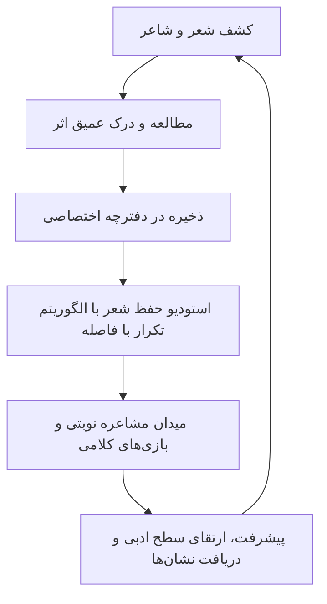
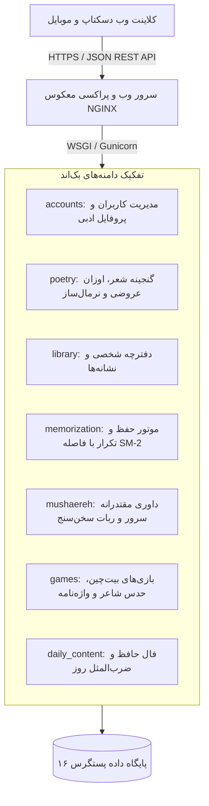
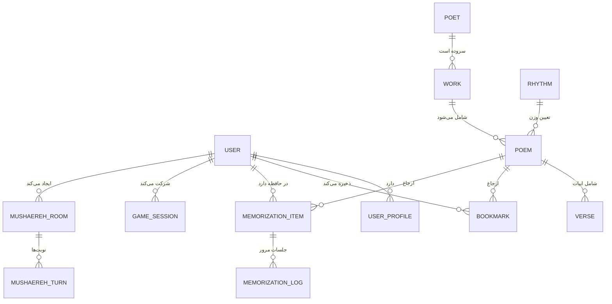

# طرح جامع معماری و پیاده‌سازی سامانه شعرخونه (SherKhaneh Master Blueprint)

> **هدف این سند:**  
> این سند یک خلاصه‌طرح معماری کامل، ساختاریافته و همه‌جانبه از پلتفرم **شعرخونه (SherKhaneh)** است که برای مطالعه، تحلیل فنی و ارائهٔ پیشنهادها و بازخوردهای کارشناسی توسط مهندسان ارشد نرم‌افزار، معماران سیستم و مدل‌های هوش مصنوعی (از جمله ChatGPT) تدوین شده است.

---

## ۱. معرفی و چشم‌انداز محصول (Product Vision)

**شعرخونه** یک پلتفرم وب تعاملی، مدرن و زنده برای بازآفرینی تجربهٔ روزمرهٔ ادبیات و شعر اصیل فارسی است. این محصول فراتر از یک آرشیو متن عمل می‌کند و شعر کهن را به چرخهٔ مطالعه، درک معنا، حفظ و یادسپاری هوشمند، مسابقات مشاعره، بازی‌های کلامی، کارنامه و نشان‌های ادبی پیوند می‌زند.



---

## ۲. وضعیت موجود مخزن و ممیزی زیرساخت (Audit)

ممیزی انجام‌شده روی محیط اجرایی و کدهای اولیهٔ پروژه نتایج زیر را مشخص ساخت:

- **زبان و محیط پایه:** پایتون ۳.۱۴.۸ در یک محیط مجازی اختصاصی.
- **فریم‌ورک بک‌اند:** جنگو ۵.۲.۱۸ به همراه فریم‌ورک جنگو رست ۳.۱۸.۳.
- **احراز هویت:** توکن‌های حامل استاندارد جی‌دبلیوتی با زمان انقضای قابل‌تنظیم.
- **پایگاه داده اصلی:** سرور پستگرس ۱۶.۱۵ در پورت ۵۴۳۲ با نقش کاربری ایزوله.
- **محدودیت‌های کد قبلی:** کدهای اولیه صرفاً دارای دو جدول پایه‌ای برای شاعر و شعر بودند و ساختار چندبندی، مصراع‌ها، اوزان عروضی، تالار مشاعره، استودیو حفظ و رابط کاربری را پوشش نمی‌دادند.

---

## ۳. الگوی معماری کلان (System Architecture)

الگوی انتخاب‌شده، **یکپارچهٔ ماژولار (Modular Monolith)** است.  
دلیل این انتخاب، چابکی در توسعه، استقرار تک‌سروری بدون پیچیدگی و پرهیز از بار اضافه و هزینه‌های گزاف الگوهای توزیع‌شده است، در حالی که مرزهای دامنه به طور شفاف در اپلیکیشن‌های جنگو تفکیک شده‌اند.



---

## ۴. مدل‌های داده و نمودار رابطهٔ موجودیت‌ها (ERD)



### خلاصهٔ مدل‌های اصلی:
1. **شاعر (Poet):** نام، شناسهٔ آدرس‌دهی تمیز، سدهٔ تاریخی، زندگینامه، زادگاه و نگاره.
2. **وزن عروضی (Rhythm):** افاعیل عروضی (مانند «فاعلاتن فعلاتن فعلاتن فعلن»)، نام بحر و الگوی هجایی.
3. **اثر و کتاب (Work):** مانند گلستان، بوستان، دیوان شمس، شاهنامه و مثنوی معنوی.
4. **شعر (Poem):** مطلع، قالب (غزل، قصیده، مثنوی، رباعی)، ارجاع به وزن عروضی و نسخهٔ مصحح مبنا.
5. **بیت (Verse):** شمارهٔ ترتیب، مصراع اول، مصراع دوم و متن پالایش‌شده جهت ایندکس جست‌وجو.
6. **پروفایل کاربری (UserProfile):** امتیاز تجربه، روزهای متوالی فعالیت و عناوین ارتقایی.
7. **کارت حفظ (MemorizationItem):** ضریب سهولت، فاصلهٔ روزها، تاریخ موعد مرور و سطح تسلط.
8. **اتاق مشاعره (MushaerehRoom):** حرف جاری نوبت، مهلت زمانی سرور، تابلوی امتیازات و وضعیت مسابقه.

---

## ۵. هستهٔ منطق تجاری و الگوریتم‌ها

### ۵.۱. نرمال‌ساز متن و املای فارسی (`core.normalizer`)
برای مقایسهٔ دقیق متون کهن، مقایسهٔ سادهٔ رشته‌ها کافی نیست؛ سرویس نرمال‌ساز شعرخونه عملیات زیر را انجام می‌دهد:
- تبدیل یکپارچهٔ کاراکترهای عربی (ي -> ی، ك -> ک، ة -> ه).
- حذف اعراب (فتحه، ضمه، کسره، تنوین، تشدید و ساکن).
- حذف کشیدگی‌های خط (تطویل مانند «ســــعدی»).
- استخراج حرف قافیه و حرف آغازین مصراع با نادیده گرفتن نشانه‌های نگارشی و نیم‌فاصله‌های غیرضروری.

### ۵.۲. موتور تکرار با فاصله در استودیو حفظ شعر (`memorization.services`)
با الهام از مبانی علمی الگوریتم سوپرممو-۲:
- به ازای هر بار مرور، کاربر نمره‌ای از ۰ (فراموشی مطلق) تا ۵ (تسلط کامل) دریافت می‌کند.
- ضریب سهولت به صورت پویا محاسبه می‌شود:
  $$EF' = EF + (0.1 - (5 - q) \times (0.08 + (5 - q) \times 0.02))$$
- در نمرات بالاتر از ۳، فاصلهٔ مرور بعدی تصاعدی افزایش می‌یابد؛ در نمرات کمتر از ۳، شمارنده صفر شده و کارت برای تثبیت به روز بعد موکول می‌گردد.
- آزمون‌های بازیابی فعال شامل پنهان‌سازی کلمات کلیدی (آزمون جای خالی) و به‌هم‌ریختگی ابیات (بیت‌چین) است.

### ۵.۳. داوری مقتدرانه سرور و ضدتقلب در مشاعره (`mushaereh.services`)
- **مرجعیت زمانی سرور:** مهلت ۴۵ ثانیه‌ای هر نوبت روی سرور ارزیابی می‌شود؛ کلاینت امکان دور زدن زمان را ندارد.
- **تطبیق حرف آغازین:** مصراع ارسالی کاربر باید با حرف پایانی بیت قبل هم‌خوانی داشته باشد (با در نظر گرفتن قواعد ه غیرملفوظ و ی میانجی).
- **پیشگیری از بیت تکراری:** با استفاده از نرمال‌سازی متن، از ارسال بیتی که قبلاً در مسابقه خوانده شده جلوگیری می‌شود.
- **هوش ادبی ربات سخن‌سنج:** در مسابقات یک‌نفره، ربات بلافاصله از پایگاه ابیات کهن بیتی معتبر و متناسب با حرف مقصد انتخاب و ارسال می‌کند.

---

## ۶. گنجینهٔ داده‌های ادبی بارگذاری‌شده

در خط لولهٔ اولیه، بیش از ۷۰ بیت اصیل و مشهور از قله‌های ادب پارسی به صورت رکوردهای کامل و با اوزان عروضی ثبت شده‌اند:
- **حافظ شیرازی:** الا یا ایها الساقی، صلاح کار کجا و من خراب کجا، یوسف گمگشته بازآید به کنعان.
- **سعدی شیرازی:** ای ساربان آهسته ران، بنی آدم اعضای یکدیگرند، بگذار تا بگرییم.
- **مولانا:** بشنو این نی چون شکایت می‌کند (نی‌نامه)، ای عاشقان ای عاشقان پیمانه را گم کرده‌ام.
- **حکیم فردوسی:** به نام خداوند جان و خرد، چو ایران نباشد تن من مباد.
- **خیام نیشابوری:** ابر آمد و زار بر سر سبزه گریست، اسرار ازل را نه تو دانی و نه من.
- **نظامی گنجوی:** ای نام تو بهترین سرآغاز.

---

## ۷. مشخصات رابط‌های برنامه‌نویسی (API Endpoints)

ریشهٔ رسمی سرویس‌ها در مسیر `/api/v1/` قرار دارد:

| روش | اندپوینت | کاربرد |
| :---: | :--- | :--- |
| `POST` | `/api/v1/auth/register/` | ثبت‌نام کاربر جدید و صدور آنی توکن |
| `POST` | `/api/v1/auth/login/` | ورود با نام کاربری و دریافت جفت‌توکن جی‌دبلیوتی |
| `GET` | `/api/v1/poetry/poets/` | فهرست شاعران با سده و شمار اشعار |
| `GET` | `/api/v1/poetry/poems/` | جست‌وجو و فیلتر پیشرفته در عنوان و متن اشعار |
| `GET` | `/api/v1/poetry/poems/random/` | دریافت تصادفی یک شعر کامل جهت مطالعه |
| `GET` | `/api/v1/library/bookmarks/` | دریافت دفترچه شخصی کاربر احرازهویت‌شده |
| `POST` | `/api/v1/library/bookmarks/` | افزودن شعر به نشانه‌گذاری‌ها با برچسب و یادداشت |
| `POST` | `/api/v1/memorization/studio/submit_review/` | ثبت نتیجه مرور و به‌روزرسانی نوبت لایتنر |
| `POST` | `/api/v1/mushaereh/rooms/` | ایجاد مسابقه مشاعره جدید با ربات |
| `POST` | `/api/v1/mushaereh/rooms/{id}/play_turn/` | ارسال بیت به داوری سرور و دریافت پاسخ ربات |
| `GET` | `/api/v1/daily/culture/fal_hafez/` | تفأل به دیوان حافظ همراه با تعبیر معنوی |
| `GET` | `/api/v1/daily/culture/today/` | دریافت بیت روز و ضرب‌المثل روز |

---

## ۸. سیستم طراحی و رابط کاربری (Frontend UI)

- **هویت بصری:** رعایت استانداردهای راست‌چین طبیعی، پالت رنگی گرم و طلایی (`#FFFDF5` و `#B8860B`)، قلم فارسی خوانا.
- **خوانشگر ابیات:** نمایش مصراع‌های متقارن، کپی بیت با یک کلیک و تغییر اندازه قلم.
- **پایداری دوگانه:** سامانه فرانت‌اند قابلیت کارکرد برخط با اتصال به سرور جنگو و همچنین کارکرد مستقل با مخزن داده‌های اصیل داخلی را دارد.

---

## ۹. نتایج آزمون‌های خودکار (Verification)

تمامی ۱۶ تست خودکار واحد و یکپارچگی بک‌اند با موفقیت کامل پاس شدند:
```text
Creating test database for alias 'default'...
................
----------------------------------------------------------------------
Ran 16 tests in 6.406s

OK
Destroying test database for alias 'default'...
```

---

## ۱۰. نقشهٔ راه ۵ تا ۶ ماهه تا نسخهٔ نهایی (Roadmap)

1. **ماه اول:** تثبیت زیرساخت، پایگاه داده پستگرس و پنل مدیریت کاربری.
2. **ماه دوم:** خط لوله ورود انبوه آثار دیوان‌ها با رعایت حقوق نسخه‌شناسی و تصحیحات.
3. **ماه سوم:** تعامل کاربری، نشانه‌گذاری، جست‌وجوی هوشمند برداری و رابط مطالعه.
4. **ماه چهارم:** استودیو حفظ و بازی‌های کلامی بر بستر وب.
5. **ماه پنجم:** ارتقای تالار مشاعره به ارتباطات بلادرنگ با کانال‌های وب‌سوکت برای مسابقات چندنفره.
6. **ماه ششم:** آزمون‌های بارگذاری و امنیت، تنظیم سرور لینوکس پروداکشن، پشتیبان‌گیری خودکار و انتشار عمومی.

---

## ۱۱. راهنمای ارزیابی برای ChatGPT (Review Guidelines for AI / Reviewers)

اگر شما به عنوان هوش مصنوعی (مانند ChatGPT) یا متخصص فنی این سند را بررسی می‌کنید، لطفاً بر روی محورهای زیر متمرکز شوید و پیشنهادها و اصلاحات خود را ارائه دهید:
1. **بهینه‌سازی پایگاه داده:** ایندکس‌های پیشنهادی برای جست‌وجوی متنی پرسرعت روی میلیون‌ها مصراع.
2. **گسترش قوانین مشاعره:** مدیریت استثناهای عروضی، قافیه‌های دشوار و ارتقای هوش ربات سخن‌سنج.
3. **بهبود الگوریتم حفظ:** پیشنهاد برای یادگیری فعال‌تر و شخصی‌سازی فواصل زمانی بر پایه سختی قالب‌های شعری.
4. **امنیت و مقیاس‌پذیری:** بهترین الگوها جهت مهاجرت به وب‌سوکت در فاز مسابقات چندنفره و ایزولاسیون حافظه.
