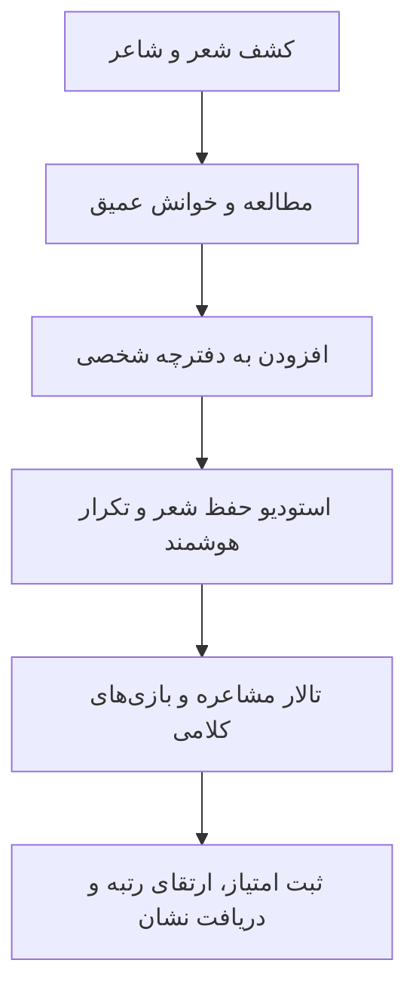

# سند جامع نیازمندی‌های محصول شعرخونه (Product Requirements Document)

این سند، اهداف بنیادین، مخاطبان هدف، حوزه‌های عملکردی و سناریوهای تجربهٔ کاربری در پلتفرم شعرخونه را مشخص می‌سازد.

---

## ۱. چشم‌انداز محصول و ارزش‌آفرینی

شعرخونه پلتفرمی تعاملی، ادبی، زیبا و روزمره برای پیوند جامعهٔ فارسی‌زبان با میراث شعر کهن و معاصر فارسی است. این محصول به یک کتابخانهٔ صامت محدود نمی‌شود؛ بلکه شعر را به چرخهٔ مطالعه، درک، حفظ و یادسپاری، رقابت جمعی، فال و حکمت روزمره پیوند می‌زند.

---

## ۲. پرسونای مخاطبان سامانه

### پرسونا ۱: دانش‌آموز و علاقه‌مند جوان ادبیات (سینا - ۱۷ ساله)
- **نیاز:** دسترسی روان به ابیات برای مطالعه، یادگیری قالب‌ها، شرکت در مشاعره با دوستان و افزایش دانش واژگان.
- **انگیزه:** دریافت نشان‌ها و امتیاز، محک زدن حافظه ادبی در بازی‌های جذاب و دسترسی سریع روی موبایل.

### پرسونا ۲: کتاب‌خوان و شیفتهٔ شعر کهن (مریم - ۳۲ ساله)
- **نیاز:** خواندن تصحیحات معتبر اشعار سعدی، حافظ و مولانا، ایجاد دفترچه اختصاصی از اشعار دلخواه و ثبت یادداشت‌های حاشیه‌ای.
- **انگیزه:** حفظ اشعار دلخواه با الگوریتم علمی تکرار با فاصله و دسترسی به فال موثق حافظ همراه با تعبیر معنوی و اخلاقی.

### پرسونا ۳: آموزگار یا سرپرست انجمن ادبی (استاد کیهان - ۵۰ ساله)
- **نیاز:** ایجاد رویدادها و اتاق‌های مشاعره سالم با داوری خودکار و نظارت بر زمان و سلامت محتوا بدون امکان تقلب.
- **انگیزه:** بستری مطمئن و فاخر با خط و زبان فارسی شیوا که کلاس درس یا دورهمی ادبی را به فضایی پویا تبدیل کند.

---

## ۳. قابلیت‌های کلیدی و سناریوهای کاربری

### ۳.۱. خانه و محتوای روزانه
- نمایش بیت روز همراه با صوت خوانش یا شرح ادبی کوتاه.
- ضرب‌المثل روز و ریشهٔ داستانی آن.
- درگاه فال حافظ با حفظ کرامت متن و تعبیر ادبی بدون خرافه‌پردازی.
- دسترسی سریع به ادامهٔ برنامهٔ مرور و یادسپاری اشعار.

### ۳.۲. گنجینه شعر و آثار بزرگان
- ساختار درختی سلسله‌مراتبی: شاعر -> اثر یا کتاب -> بخش یا باب -> شعر -> بند یا بیت -> مصراع.
- امکان جست‌وجوی بلادرنگ در عنوان، متن مصراع‌ها، وزن عروضی، قالب شعری و سدهٔ تاریخی.
- صفحه اختصاصی شعر با قابلیت تغییر اندازه قلم، حالت مطالعه شب، کپی مصراع، نشانه‌گذاری و ارجاع دقیق به تصحیح منبع.

### ۳.۳. استودیو حفظ و یادسپاری شعر (Spaced Repetition)
- پیاده‌سازی متد لایتنر و تکرار با فاصله برای تثبیت اشعار در حافظه بلندمدت.
- تمرین‌های بازیابی فعال:
  1. تکمیل جای خالی در مصراع (کلمات کلیدی پنهان‌شده)
  2. مرتب‌سازی مصراع‌های به‌هم‌ریخته (بیت‌چین)
  3. بازخوانی ذهنی و خودارزیابی بر اساس ضریب تسلط
- ثبت روزانه جلسات تمرین و نمایش وضعیت تسلط هر بیت در قالب کارت‌های رنگی.

### ۳.۴. تالار مشاعره (Mushaereh Arena)
- امکان مشاعره با ربات هوشمند ادبی (سخن‌سنج) یا رقابت نوبتی کاربران.
- داوری بی‌طرف و قاطع سمت سرور:
  1. تشخیص حرف پایانی مصراع قبل و تطبیق با حرف آغازین مصراع جدید
  2. بررسی تکراری نبودن بیت در همان دور یا اتاق
  3. اعمال محدودیت زمانی برای هر نوبت به صورت مقتدرانه از سوی سرور
  4. اعمال قواعد خاص حروف مانند «ه» ناملفوظ و «ی» میانجی
- جدول رده‌بندی و امتیازدهی عادلانه بر اساس وزن و درجه دشواری بیت.

### ۳.۵. مرکز بازی‌های ادبی (Literary Games Hub)
- **بیت‌چین:** چیدمان به ترتیب ابیات پریشان‌شده در کوتاه‌ترین زمان.
- **حدس شاعر:** تشخیص صاحب اثر بر پایهٔ یک بیت شاخص و تخلص.
- **یادآوری مصراع دوم:** نمایش مصراع نخست و فراخوانی مصراع مکمل.
- **واژه‌نامه ادب:** سنجش فهم معانی کلمات کهن و ترکیبات کنایی.

### ۳.۶. دفترچه شخصی و هویت کاربری
- ذخیره شعر در دسته‌بندی‌های شخصی (عاشقانه، حماسی، پندآموز، عارفانه).
- کارنامه فعالیت‌ها، روزهای پیاپی تمرین (Streak) و مدال‌های مفاخر ادب فارسی.
