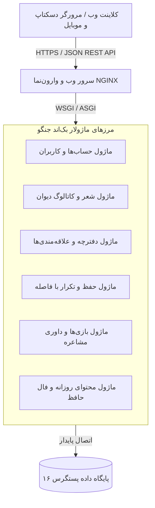
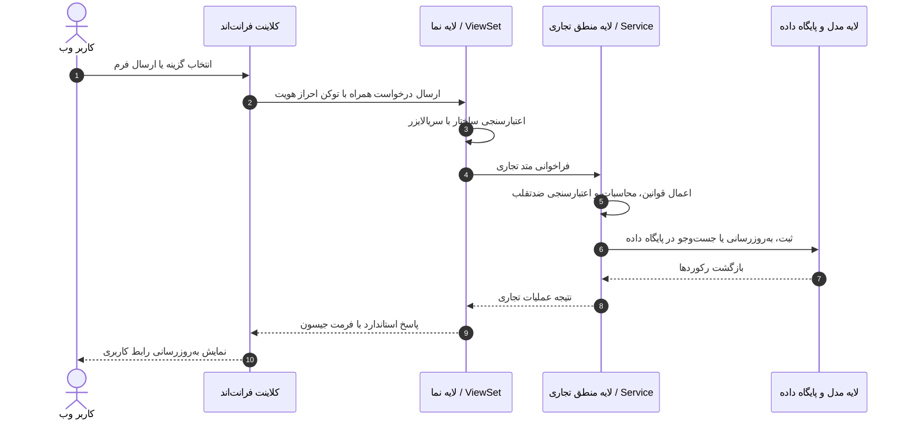

# معماری کلان سیستم شعرخونه (System Architecture)

این سند، معماری فنی، مرزهای دامنه و نحوهٔ جریان داده و درخواست‌ها را در سامانهٔ شعرخونه تبیین می‌کند.

---

## ۱. الگوی معماری: یکپارچه ماژولار (Modular Monolith)

رویکرد انتخابی برای شعرخونه، معماری یکپارچه ماژولار است. در این الگو:
- هسته برنامه واحد و توسعه‌پذیر در قالب یک پروژه جنگو مدیریت می‌شود.
- مرزهای دامنه‌ای به وضوح در قالب اپلیکیشن‌های مستقل و تخصصی تفکیک شده‌اند.
- منطق کسب‌وکار در لایه سرویس متمرکز است و ویوها صرفاً هدایت‌کننده درخواست و پاسخ هستند.
- از پیچیدگی‌های زودرس مایکروسرویس‌ها، سربار شبکه و هزینه‌های گزاف استقرار اجتناب می‌گردد.

---

## ۲. جریان پردازش درخواست‌ها (Request Lifecycle)

---

## ۳. امنیت، ثبات و انعطاف‌پذیری
1. **احراز هویت:** بر پایه استاندارد توکن حامل با دوره انقضای مشخص و اعتبارسنجی خودکار.
2. **پایداری داده‌ها:** پایگاه داده پستگرس به عنوان منبع واحد حقیقت داده‌های ادبی و کاربری.
3. **لایه خدمات مستقل:** جداسازی منطق بازی و حفظ شعر از لایه پایگاه داده به منظور تسهیل تست‌های خودکار.
