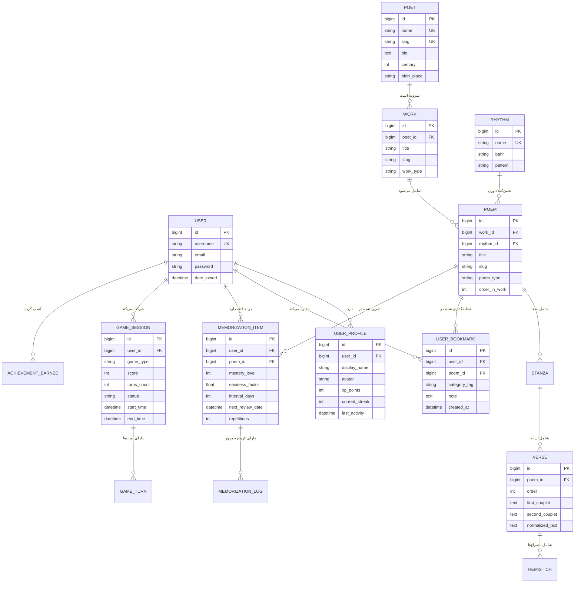

# نمودار جامع ارتباط موجودیت‌ها (Database ERD)

این سند، دیاگرام ارتباط میان موجودیت‌های داده‌ای سامانه شعرخونه را با نمادگذاری استاندارد ارائه می‌کند.

---

## ۱. نمودار روابط موجودیت‌ها

---

## ۲. توضیحات روابط ساختاری داده‌ها
1. **سلسله‌مراتب شعر:** هر شاعر آثاری دارد، هر اثر اشعاری دارد، و هر شعر به ابیات و مصراع‌ها با ترتیب قطعی متصل است.
2. **استودیو یادسپاری:** هر کاربر به ازای هر شعر انتخابی، یک آیتم یادسپاری فعال دارد که داده‌های ضریب آسانی و دوره تکرار را نگهداری می‌کند.
3. **دفترچه شخصی:** کاربر می‌تواند اشعار دلخواه را با برچسب‌های دلخواه و یادداشت شخصی نشانه‌گذاری کند.
4. **نشست‌های بازی:** هر دست بازی یا مشاعره به عنوان یک نشست مستقل همراه با امتیاز و تاریخچه نوبت‌ها ثبت می‌شود.
