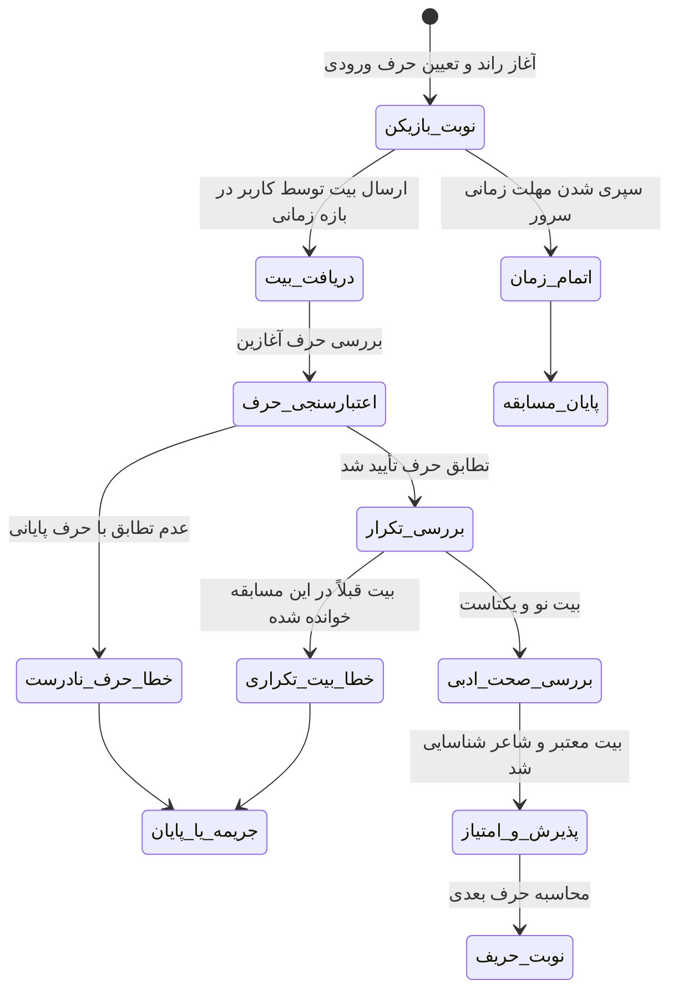

# قوانین رسمی بازی‌ها، داوری مشاعره و مکانیزم ضدتقلب (Game Rules & Anti-Cheat)

این سند، قواعد تجاری، ماشین حالت (State Machine)، اصول داوری سخت‌گیرانه سمت سرور و مقابله با تقلب در مشاعره و بازی‌های کلامی شعرخونه را مشخص می‌کند.

---

## ۱. منطق و قوانین داوری مشاعره (Mushaereh Arbiter)

مشاعره در شعرخونه نه بر اساس کدنویسی ظاهری در کلاینت، بلکه با اتوریتی مطلق سمت سرور قضاوت می‌شود:

### ۱.۱. قوانین خاص حروف و املای فارسی:
- **حرف «ه» غیرملفوظ:** کلماتی مانند «خانه»، «نامه» یا «سایه» که به مصوت کوتاه ختم می‌شوند در مشاعره سنتی گاهی با «الف» و گاهی با «ه» پاسخ داده می‌شوند؛ در شعرخونه هر دو حالت بر اساس تنظیمات رسمی قابل قبول است ولی به طور پیش‌فرض حرف صامت «ه» مبنا است.
- **حرف «ی» میانجی:** در ترکیب‌های اضافی مانند «بلبلِ بستان»، حرف پایانی واژه مبناست، نه کسره اضافه یا علامت شناسه.
- **حذف تشدید و اعراب:** اعتبارسنجی تطابق حرف آغاز و پایان پس از حذف تمامی علائم اعراب‌گذاری صورت می‌پذیرد.

---

## ۲. مکانیزم‌های ضدتقلب (Anti-Cheat Measures)

1. **مرجعیت زمانی سرور (Server-Authoritative Clock):** زمان هر نوبت (مثلاً ۴۵ ثانیه) روی سرور محاسبه می‌شود. هیچ تایمر سمت کلاینت قادر به دور زدن مهلت نیست.
2. **بررسی تکرار هم‌زمان و قفل پایگاه داده (Concurrency Locking):** با استفاده از تراکنش‌های ایزوله، از ثبت یک بیت در یک هزارم ثانیه توسط دو نفر در یک اتاق جلوگیری می‌شود.
3. **سنجش املایی و بانک ابیات معتبر:** شعر ارسالی کاربر باید در بانک دیوان شعرخونه یا منابع معتبر ثبت شده باشد تا از ارسال جملات بی‌معنی یا نامنظوم تصادفی جلوگیری گردد.
4. **محدودسازی نرخ ارسال (Rate Limiting):** جلوگیری از حملات ربات‌های اسپمر از طریق ارسال درخواست‌های میلی‌ثانیه‌ای با محدودسازی نرخ دسترسی آی‌پی.
