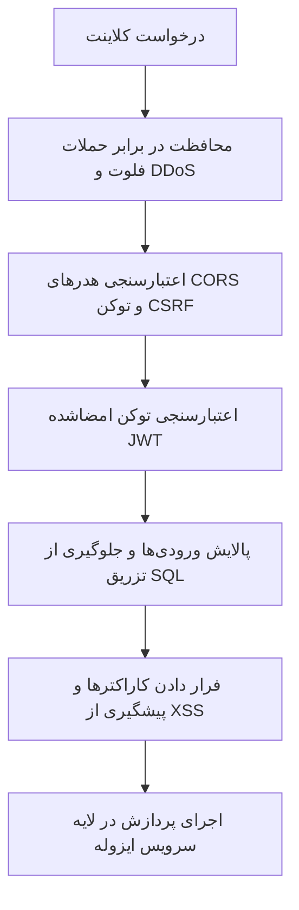

# ارزیابی امنیت و حریم خصوصی کاربران (Security & Privacy Review)

این سند، راهبردهای دفاع در عمق، حفاظت از داده‌های شخصی و اقدامات پیشگیرانه در برابر مخاطرات امنیتی را در پلتفرم شعرخونه تبیین می‌کند.

---

## ۱. اصول حریم خصوصی و کمینه‌سازی داده‌ها (Data Minimization)

- **داده‌های ثبت‌نامی حداقلی:** تنها نام کاربری، رایانامه و گذرواژه هش‌شده ذخیره می‌شود. هیچ‌گونه اطلاعات حساس هویتی از کاربر تقاضا نمی‌گردد.
- **تفکیک داده‌های خصوصی:** یادداشت‌ها، وضعیت حفظ و نشانه‌گذاری‌های هر کاربر تنها با احراز هویت توکن متعلق به همان کاربر قابل خواندن است و به صورت تصادفی یا عمومی افشا نمی‌شود.
- **حق فراموشی (Account Deletion):** در تنظیمات کاربری، گزینه حذف کامل حساب و پاکسازی رکوردهای مربوطه پیش‌بینی می‌شود.

---

## ۲. تمهیدات امنیتی در معماری بک‌اند

1. **مدیریت ایمن گذرواژه‌ها:** استفاده از الگوریتم استاندارد هش‌کردن چندباره جنگو (`PBKDF2 with SHA256`)؛ گذرواژه‌ها تحت هیچ شرایطی به صورت متن آشکار ثبت یا چاپ نمی‌شوند.
2. **پیکربندی کلیدهای محرمانه:** کلیه اطلاعات اتصال به پایگاه داده و کلید اصلی رمزنگاری از طریق متغیرهای محیطی لود شده و از قرارگیری در کدهای عمومی یا گیت محافظت می‌گردند.
3. **پیشگیری از تزریق کد و اسکریپت مخرب (XSS & Injection):** تمام فیلدهای جست‌وجو و کامنت‌های کاربران در هنگام درج در پایگاه داده با استفاده از سازوکار امن جنگو و سریالایزرهای استاندارد اعتبارسنجی و پالایش می‌شوند.
4. **تنظیمات اشتراک منابع فرامبدأ (CORS):** در محیط تولید، مبدأهای مجاز به دامنه‌های رسمی سامانه محدود می‌گردند.
