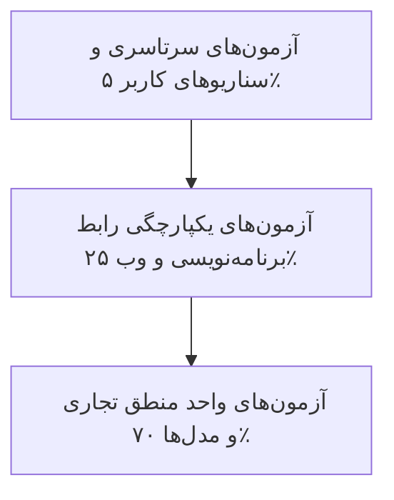

# راهبرد جامع آزمون و مهندسی کیفیت (Test & Quality Strategy)

این سند، سطوح مختلف آزمون خودکار، معیارهای پوشش کد و الزامات اعتبارسنجی کیفی پلتفرم شعرخونه را مشخص می‌کند.

---

## ۱. هرم آزمون‌های سامانه (Testing Pyramid)

### ۱. آزمون‌های واحد (Unit Tests)
- اعتبارسنجی الگوریتم پالایش و نرمال‌سازی کلمات و حروف فارسی.
- محاسبه صحیح فواصل زمانی الگوریتم تکرار با فاصله (SuperMemo-2 / Leitner).
- اعتبارسنجی قوانین تطبیق حرف مشاعره، حذف اعراب و تمایز حروف پایانی.
- بررسی متدهای مدل‌ها و ایجاد رکوردهای تودرتوی ابیات و مصراع‌ها.

### ۲. آزمون‌های یکپارچگی (API Integration Tests)
- فرآیند ثبت‌نام کاربر، دریافت توکن و ورود موفق/ناموفق.
- جست‌وجوی شعر با کلمات کلیدی، نام شاعر و تست فیلترهای ترکیبی.
- ذخیره شعر در دفترچه شخصی و تست جلوگیری از نشانه‌گذاری تکراری.
- ثبت نوبت در مسابقه مشاعره، تست خطای بیت تکراری و نوبت غیرمجاز.

### ۳. آزمون‌های سرتاسری (End-to-End Scenarios)
- گردش کامل یک کاربر جدید از ورود، مطالعه غزل، تفأل به دیوان حافظ، نشانه‌گذاری در دفترچه شخصی و انجام یک دور بازی بیت‌چین.

---

## ۲. تعریف رسمی آماده‌بودن برای انتشار (Definition of Done)

یک قطعه‌کد یا قابلیت تنها زمانی تکمیل‌شده تلقی می‌شود که:
1. آزمون‌های واحد و رابط برنامه‌نویسی مربوطه با موفقیت پاس شوند.
2. هیچ خطای امنیتی بحرانی یا درز اطلاعات محرمانه در لاگ‌ها مشاهده نشود.
3. متغیرها و نام‌گذاری‌ها مطابق استانداردهای طراحی بوده و با رابط راست‌چین سازگار باشند.
4. مستندات مربوطه در اسناد معماری یا فایل مشخصات رابط برنامه‌نویسی به‌روزرسانی گردد.
