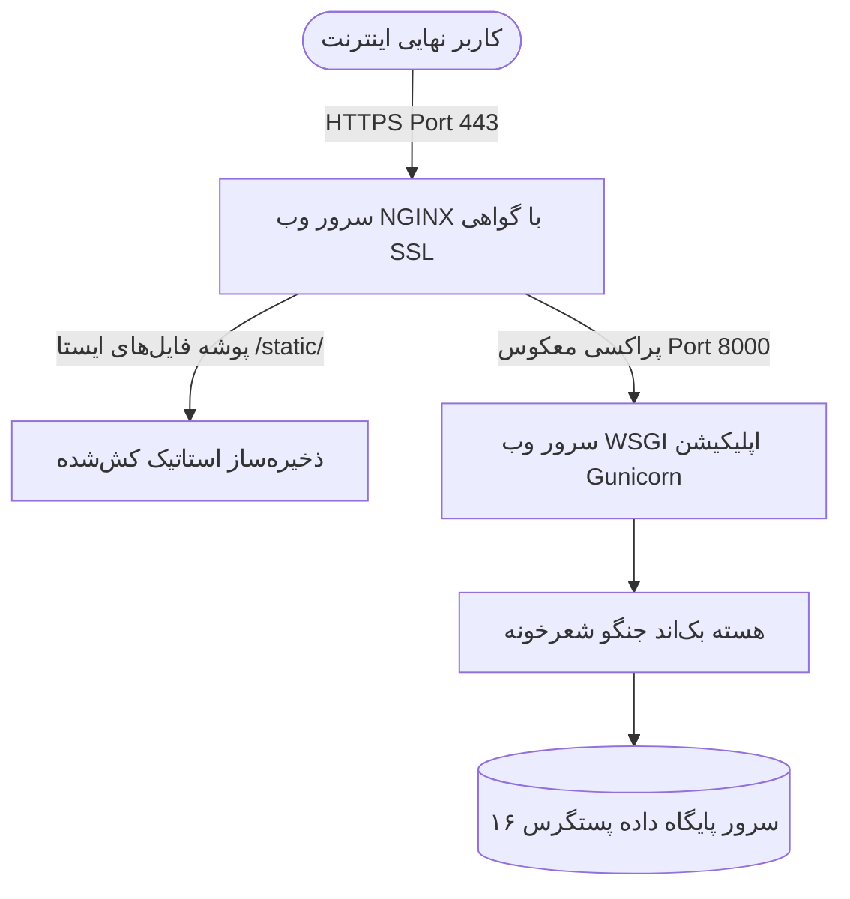

# راهبرد استقرار، عملیات، پایش و نگهداری (Deployment & Operations)

این سند، مشخصات محیط تولید، معماری سرور، فرآیند استقرار خودکار و راهنمای بازیابی پس از سانحه را تشریح می‌کند.

---

## ۱. معماری زیرساخت استقرار در محیط عملیاتی



---

## ۲. چک‌لیست امنیتی استقرار نهایی (Production Hardening)

- [ ] غیرفعال‌سازی حالت دیباگ (`DEBUG = False`).
- [ ] تولید کلید محرمانه اختصاصی و غیرقابل پیش‌بینی در فایل محیطی سرور.
- [ ] فعال‌سازی هدرهای امنیتی:
  ```text
  SECURE_SSL_REDIRECT = True
  SESSION_COOKIE_SECURE = True
  CSRF_COOKIE_SECURE = True
  SECURE_BROWSER_XSS_FILTER = True
  SECURE_CONTENT_TYPE_NOSNIFF = True
  ```
- [ ] تعیین صریح دامنه‌های مجاز در `ALLOWED_HOSTS`.

---

## ۳. سیاست پشتیبان‌گیری و بازیابی پایگاه داده (Backup & Disaster Recovery)

1. **تهیه پشتیبان روزانه خودکار:** اجرای دستور پشتیبان‌گیری پستگرس به صورت رمزگذاری‌شده در هر بامداد:
   ```bash
   pg_dump -U sherkhane_app -F c -b -v -f /backups/sherkhane_$(date +%Y%m%d).dump sherkhane
   ```
2. **سیاست نگهداری (Retention):** نگهداری فایل‌های روزانه برای ۳۰ روز و پشتیبان‌های ماهانه برای ۱ سال.
3. **آزمون دوره‌ای بازیابی:** تست منظم بازیابی فایل پشتیبان در محیط آزمایشی جهت اطمینان از سلامت باینری‌ها و یکپارچگی ارجاعات.
