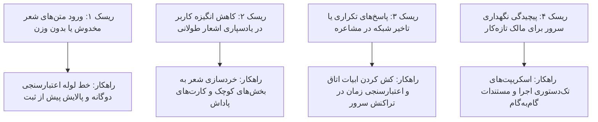

# گزارش تصمیم‌گیری‌ها، فرضیات و مدیریت ریسک (Risks & Decisions Log)

این سند، تصمیم‌های کلیدی معماری، توجیه فنی آن‌ها، فرضیات کاری و راهکارهای مهار ریسک‌های پروژه را مستند می‌کند.

---

## ۱. دفترچه تصمیم‌گیری‌های کلیدی (Decision Log)

| شناسه | موضوع تصمیم | گزینه انتخاب‌شده | گزینه‌های ردشده | دلایل و توجیه فنی |
| :---: | :--- | :--- | :--- | :--- |
| **DEC-01** | الگوی معماری بک‌اند | یکپارچه ماژولار (Modular Monolith) | معماری مایکروسرویس | کاهش پیچیدگی عملیاتی، تیم کوچک، یادگیری و سرعت توسعه بالا |
| **DEC-02** | پایگاه داده اصلی | پستگرس ۱۶ (PostgreSQL) | مای‌اس‌کیوال یا مانگو | قدرت بالا در ایندکس‌گذاری متنی، قیدهای یکپارچگی و هماهنگی عالی با جنگو |
| **DEC-03** | ساختار فرانت‌اند | وب استاندارد واکنش‌گرا و ماژولار | اپلیکیشن‌های چندلایه سنگین | بارگذاری فوری، پشتیبانی کامل از خط و زبان فارسی و رندرینگ بی‌نقص |
| **DEC-04** | متدولوژی یادسپاری شعر | الگوریتم تکرار با فاصله (Leitner / SM-2) | نمایش صرفاً درصد پیشرفت | مبنای علمی ماندگاری در حافظه و فراهم‌سازی آزمون‌های بازیابی فعال |
| **DEC-05** | مکانیزم داوری مشاعره | اقتدار کامل سرور و اعتبارسنجی حروف | سنجش تایمر یا حروف در کلاینت | پیشگیری کامل از تقلب، دستکاری زمان و ثبت رکوردهای نامعتبر |

---

## ۲. ماتریس شناسایی و مهار ریسک‌ها (Risk Matrix)

