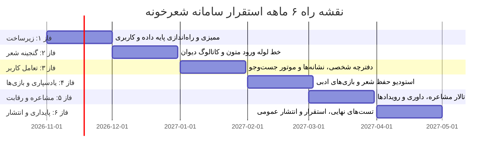

# نقشه راه جامع پنج تا شش ماهه (5 to 6 Month Roadmap)

این سند، برنامه‌ریزی واقع‌بینانه و زمان‌بندی فازهای توسعهٔ پروژهٔ شعرخونه را بر مبنای توان تیم و دستیابی به محصولی پایدار تدوین نموده است.

---

## ۱. نمای کلی زمان‌بندی فازها

---

## ۲. خروجی‌ها و معیارهای خروج هر ماه

### ماه اول — پی‌ریزی و هستهٔ زیرساخت (Foundation)
- خروجی: پایگاه داده پستگرس آماده، مدل کاربری سفارشی، سرویس‌های اعتبارسنجی احراز هویت، پنل مدیریت فارسی و اسناد اولیه.
- معیار خروج: ثبت‌نام، ورود و احراز هویت با توکن به طور کامل پاس شود.

### ماه دوم — گنجینهٔ کهن و پالایش متون (Poetry Core)
- خروجی: مدل‌های ساختاربندی‌شده شاعر، دیوان، قالب، وزن عروضی، بیت و مصراع؛ ورود دیوان حافظ و غزلیات سعدی.
- معیار خروج: صحت ثبت و جست‌وجوی دقیق مصراع‌ها با نرمال‌سازی املایی تایید گردد.

### ماه سوم — حساب، دفترچه و جست‌وجو (Personal Library)
- خروجی: قابلیت نشانه‌گذاری اشعار دلخواه، دسته‌بندی شخصی، یادداشت‌گذاری و اتصال کامل فرانت‌اند گنجینه.
- معیار خروج: کاربر بتواند اشعار را جست‌وجو کرده و در دفترچه ذخیره و سازماندهی کند.

### ماه چهارم — استودیو حفظ شعر و بازی‌های کلامی (Memorization & Games)
- خروجی: پیاده‌سازی متد لایتنر و تکرار با فاصله، تمرینات جای خالی و مرتب‌سازی ابیات (بیت‌چین)، کوییز واژگان.
- معیار خروج: جلسات تمرین حفظ بدون اشکال ذخیره شده و ضریب تسلط به طور علمی محاسبه شود.

### ماه پنجم — تالار مشاعره و گردونه رویدادها (Mushaereh Arena)
- خروجی: پیاده‌سازی داوری مقتدرانه سرور، قوانین تطبیق حروف فارسی، تایمر نوبت، امتیازدهی و رویدادها.
- معیار خروج: انجام یک مسابقه مشاعره با ربات و تست موفق سناریوهای حروف نامعتبر یا بیت تکراری.

### ماه ششم — پایداری، بازبینی امنیتی و انتشار (Hardening & Release)
- خروجی: اجرای آزمون‌های سرتاسری، فعال‌سازی حالت پروداکشن، پیکربندی سرور وب، اسکریپت بکاپ و ارائه راهنمای مدیریت به مالک.
- معیار خروج: محصول بدون خطای باز روی سرور آماده بهره‌برداری عمومی باشد.
